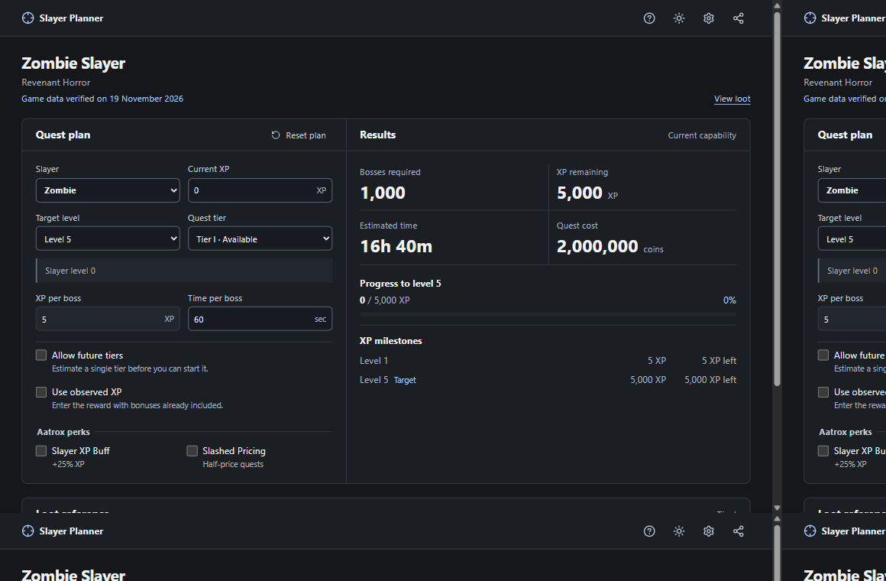

# Slayer Planner

An offline Hypixel SkyBlock Slayer planner for mapping XP, quest access, time, cost, and loot before you start grinding.

More views: [future-tier estimate](docs/screenshots/planner-future-tier.png), [loot audit](docs/screenshots/planner-loot-audit.png), and [mobile web version](docs/screenshots/planner-web-mobile.png).

## Download and use

- [Download the latest desktop release](https://github.com/bp1409/slayer-planner/releases/latest)
- [Open the web version](https://bp1409.github.io/slayer-planner/)

The web version is static and works offline after its first load. Production desktop builds block WebView network requests. Plans, preferences, and the last valid workspace are stored locally.

## Why use it

- No account required.
- No API key required.
- Works offline.
- Uses an audited game-data model with dated sources and discrepancy notes in [`frontend/GAME-DATA.md`](frontend/GAME-DATA.md).
- Keeps calculation and validation independent from React.
- Includes explicit access checks instead of silently assuming future-tier unlocks.

## macOS note

The macOS app is unsigned. If Gatekeeper blocks it, Control-click the app in Finder, choose **Open**, then confirm **Open**. You may need to repeat this after downloading a newer build.

Updater signing is not configured in this repository yet. Before publishing updater-enabled builds, generate a Tauri updater key pair locally, keep the private key and password in GitHub Actions secrets, put only the public key in `frontend/src-tauri/tauri.conf.json`, and publish the signed `latest.json` plus matching assets. The updater setting is off by default.

## Release checklist

- Enable GitHub Pages with **Source: GitHub Actions** if it is not already enabled.
- Paste the entries from [`TOPICS.txt`](TOPICS.txt) into the repository topic settings.
- If using auto-update, generate the Tauri updater key pair and add the private key and password as repository secrets; never commit them.
- Push the `v1.1.0` tag, then run the desktop release workflow for that tag.

## Contributing

Use Node.js 22.18 or newer, then run `npm ci` and `npm run dev` in [`frontend/`](frontend/). Before opening a pull request, run `npm test`, `npm run typecheck`, `npm run build`, and `npm run test:e2e`. Preserve the offline desktop boundary, design tokens, keyboard accessibility, reduced-motion behavior, and calculator tests.

Game-data changes require a dated source or an explicit discrepancy note in [`frontend/GAME-DATA.md`](frontend/GAME-DATA.md). See [`frontend/README.md`](frontend/README.md) for desktop prerequisites.

The offline Profit view is implemented with user-entered approximate prices. See [`docs/online-features.md`](docs/online-features.md) for the proposed, approval-required web-only price refresh and username-import design; neither network feature is implemented.
